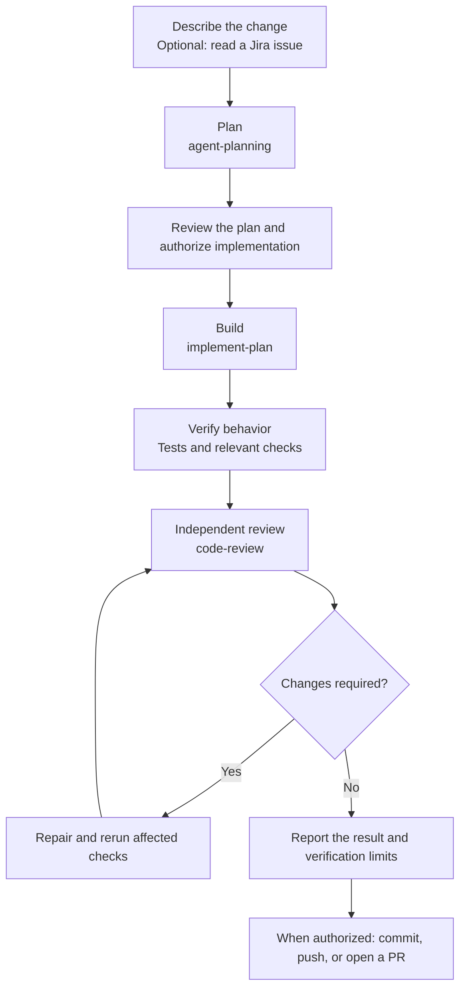

# ai-agent-skills

22 shared engineering skills for AI coding agents. Plan, build, test, review,
and prepare delivery with consistent workflows and explicit authorization.

## Install

Choose a distribution path:

| Path | Requirements | Installs |
| --- | --- | --- |
| Open Skills CLI (`npx skills`) | Node.js/npm and Git; no manual clone | Skill folders and supporting resources for supported agents |
| Native shell installers | Bash and platform tools, or PowerShell; no Node.js or Go | Release bundles, including host routing and optional specialized agents where supported |

See the [host compatibility matrix](docs/host-compatibility.md) for native skill
discovery, automatic selection, app/CLI differences, and verified limitations.

### Open Skills CLI

Run from your target project directory:

```sh
npx skills add TylerAkins/ai-agent-skills
```

Select your agents and skills interactively. To list skills or select one by name:

```sh
npx skills add TylerAkins/ai-agent-skills --list
npx skills add TylerAkins/ai-agent-skills --skill test-authoring

# Install globally for all projects/workspaces
npx skills add TylerAkins/ai-agent-skills -g

# Update installed skills to the latest revision
npx skills update
```

Skills link to other skills in this collection. Install the collection when you
need those workflows; a single skill retains its own `references/` resources but
does not install sibling skills automatically. See the
[Open Skills CLI documentation](https://github.com/vercel-labs/skills) for supported
agents, global installation, and updates. The CLI distributes files; whether a
host selects a skill automatically depends on that host's native behavior.

### Native Shell Installers

Expand your host below for installation, activation, and updates. These installers
use Bash on macOS/Linux or PowerShell on Windows with the prerequisites below;
they do not require a Node.js runtime or additional language package installation.

Install the host app and Git first. On **macOS/Linux**, you also need Bash, curl,
tar, shasum, and jq. macOS includes Bash, curl, tar, and shasum; with Homebrew,
install jq using `brew install jq`. On Linux, use your package manager for missing tools.
On **Windows**, use [PowerShell 7.4+](https://learn.microsoft.com/en-us/powershell/scripting/install/installing-powershell-on-windows),
not Windows PowerShell 5.1. No Bash or jq is needed on Windows.

Clone once, then run your host's commands below from this checkout.

**macOS / Linux**

```sh
git clone https://github.com/TylerAkins/ai-agent-skills.git
cd ai-agent-skills
```

**Windows**

```powershell
git clone https://github.com/TylerAkins/ai-agent-skills.git
Set-Location ai-agent-skills
```

For an existing checkout, skip cloning. Before updating from a published release,
run `git pull --ff-only` once, then use your host's update command below. Skills-only
and agent-only updates use merge to preserve unrelated files; plugin updates replace
the plugin with a backup. If you have uncommitted changes, do not pull over them.
The new agent-only flavors require a published release containing the agent
bundles; older releases cannot install them.

<a id="cursor"></a>
<details>
<summary><strong>Cursor</strong></summary>

### Install on macOS / Linux

```sh
bash scripts/install-ai-agent-skills.sh --flavor cursor
```

### Install on Windows

```powershell
./scripts/install-ai-agent-skills.ps1 -Flavor cursor
```

### Activate and check

Run **Developer: Reload Window** from Cursor's Command Palette
(`Cmd+Shift+P` on Mac, `Ctrl+Shift+P` on Windows/Linux). Open **Customize** and
check for **ai-agent-skills**, its skills, routing rule, and four agents. Start a new
Agent chat and ask for an implementation plan without naming a skill.

Local plugin imports must be allowed by your account/team. A marketplace copy
with the same name can take precedence. The plugin rule now defers clear skill matches
to Cursor's native selection. Cursor CLI also supports loading a local plugin for a
session:

```sh
agent --plugin-dir "$HOME/.cursor/plugins/local/ai-agent-skills"
```

See [Cursor plugins](https://cursor.com/docs/plugins) and the
[CLI plugin parameters](https://cursor.com/docs/cli/reference/parameters).

### Direct global skills for Cursor IDE or CLI

To install skills in Cursor's native user directory without installing the plugin:

```sh
bash scripts/install-ai-agent-skills.sh --flavor cursor-global
```

```powershell
./scripts/install-ai-agent-skills.ps1 -Flavor cursor-global
```

Start a new session and verify the skills in **Customize > Skills** or the CLI's
skill list. For updates, use `update` / `-Action Update` with `--merge` / `-Merge`.

### Update

Run from this checkout:

**macOS / Linux**

```sh
bash scripts/install-ai-agent-skills.sh update --flavor cursor
```

**Windows**

```powershell
./scripts/install-ai-agent-skills.ps1 -Action Update -Flavor cursor
```

Confirm replacement, reload Cursor, and start a new chat.

</details>

<a id="codex"></a>
<details>
<summary><strong>Codex</strong></summary>

### Install on macOS / Linux

```sh
bash scripts/install-ai-agent-skills.sh --flavor codex-desktop
```

### Install on Windows

```powershell
./scripts/install-ai-agent-skills.ps1 -Flavor codex-desktop
```

### Activate and check

Quit and reopen ChatGPT/Codex. In **Plugins**, select your personal marketplace
and install **ai-agent-skills**. Start a new chat and describe the task without
naming a skill.

The helper installs files in `~/.codex/plugins/ai-agent-skills` and merges an entry
into `~/.agents/plugins/marketplace.json`, preserving other plugins and metadata.
You complete activation in the app. It does not register a CLI marketplace.
See [OpenAI local marketplaces](https://developers.openai.com/plugins/build/plugins).

### Native global skills for Codex CLI and IDE extension

Install directly to Codex's user-level Agent Skills directory:

```sh
bash scripts/install-ai-agent-skills.sh --flavor codex-global
```

```powershell
./scripts/install-ai-agent-skills.ps1 -Flavor codex-global
```

Start a new Codex session and describe the task normally. Codex selects matching
skills from their descriptions. This path is separate from the desktop plugin and
does not change Codex configuration. For updates, use `update` / `-Action Update`
with `--merge` / `-Merge`. The shared `~/.agents/skills` directory is also read by
other compatible hosts.

### Optional native subagents

For the four investigation agents, install the native skills above and the agent
definitions separately. The desktop plugin alone does not install native Codex agents.

```sh
bash scripts/install-ai-agent-skills.sh --flavor codex-agents-global
bash scripts/install-ai-agent-skills.sh update --flavor codex-agents-global --merge
```

```powershell
./scripts/install-ai-agent-skills.ps1 -Flavor codex-agents-global
./scripts/install-ai-agent-skills.ps1 -Action Update -Flavor codex-agents-global -Merge
```

For project-scoped definitions, use `codex-agents-project` with `--project` /
`-Project` and install project skills with `codex-skills`. See
[agent paths and update policy](docs/installer-reference.md#specialized-agent-installations).

### Update desktop plugin

Run from this checkout:

**macOS / Linux**

```sh
bash scripts/install-ai-agent-skills.sh update --flavor codex-desktop
```

**Windows**

```powershell
./scripts/install-ai-agent-skills.ps1 -Action Update -Flavor codex-desktop
```

Confirm replacement, refresh/reinstall the plugin in Codex if its cached copy stays old,
and start a new chat.

For project skills or a separate marketplace root, see
[alternate installations](docs/installer-reference.md#alternate-installations).

</details>

<a id="claude-code"></a>
<details>
<summary><strong>Claude Code</strong></summary>

### Install on macOS / Linux

```sh
bash scripts/install-ai-agent-skills.sh --flavor claude
```

### Install on Windows

```powershell
./scripts/install-ai-agent-skills.ps1 -Flavor claude
```

### Activate and check

Launch Claude Code with the installed plugin directory.

**macOS / Linux**

```sh
claude --plugin-dir "$HOME/.local/share/ai-agent-skills/claude"
```

**Windows**

```powershell
claude --plugin-dir "$env:USERPROFILE/.local/share/ai-agent-skills/claude"
```

The plugin exposes namespaced skill commands. `--plugin-dir` loads it for that
session, so pass the flag when launching later sessions too. The helper does not
configure a persistent marketplace. See [Claude plugins](https://code.claude.com/docs/en/plugins).

### Native personal or project skills

For persistent Claude Code skill directories, use `claude-global` or
`claude-project` instead of the plugin flavor:

```sh
bash scripts/install-ai-agent-skills.sh --flavor claude-global
bash scripts/install-ai-agent-skills.sh --flavor claude-project --project /absolute/path/to/project
```

```powershell
./scripts/install-ai-agent-skills.ps1 -Flavor claude-global
./scripts/install-ai-agent-skills.ps1 -Flavor claude-project -Project 'C:/path/to/project'
```

Start a new Claude Code session, check `/skills`, and ask for ordinary work without
naming a skill. Claude can select skills based on their descriptions. For updates,
use `update` / `-Action Update` and `--merge` / `-Merge` with the same target. The
global flavor honors an absolute `CLAUDE_CONFIG_DIR` when it is set.
The installed `code-review` skill takes the `/code-review` name used by Claude's
built-in skill; Claude's `/review` alias remains available.

### Optional native subagents

The Claude plugin already includes the four investigation agents. For persistent
native agents instead, install the skills above and add the agent definitions:

```sh
bash scripts/install-ai-agent-skills.sh --flavor claude-agents-global
bash scripts/install-ai-agent-skills.sh update --flavor claude-agents-global --merge
```

```powershell
./scripts/install-ai-agent-skills.ps1 -Flavor claude-agents-global
./scripts/install-ai-agent-skills.ps1 -Action Update -Flavor claude-agents-global -Merge
```

For project scope, use `claude-agents-project` with `--project` / `-Project`
alongside `claude-project` skills. The global agent flavor honors
`CLAUDE_CONFIG_DIR`. See [agent paths and update policy](docs/installer-reference.md#specialized-agent-installations).

### Update plugin

Run from this checkout:

**macOS / Linux**

```sh
bash scripts/install-ai-agent-skills.sh update --flavor claude
```

**Windows**

```powershell
./scripts/install-ai-agent-skills.ps1 -Action Update -Flavor claude
```

Confirm replacement, then launch a new Claude Code session with `--plugin-dir` as above.

</details>

<a id="github-copilot"></a>
<details>
<summary><strong>GitHub Copilot app</strong></summary>

### Install on macOS / Linux

```sh
bash scripts/install-ai-agent-skills.sh --flavor copilot-global
```

### Install on Windows

```powershell
./scripts/install-ai-agent-skills.ps1 -Flavor copilot-global
```

### Activate and check

The helper installs skills in `~/.copilot/skills` for use across projects.

Open the project in the Copilot app, start a new session, and check
**Customize > Skills**. Ask it to plan a feature without naming a skill. See
[Copilot app customization](https://docs.github.com/en/copilot/how-tos/github-copilot-app/customize-github-copilot-app).

### Update

Run from this checkout:

**macOS / Linux**

```sh
bash scripts/install-ai-agent-skills.sh update --flavor copilot-global --merge
```

**Windows**

```powershell
./scripts/install-ai-agent-skills.ps1 -Action Update -Flavor copilot-global -Merge
```

Merge replaces this collection's skill folders and preserves unrelated skills. Start a new host session.

For repository-specific skills, use `copilot-skills` with `--project` / `-Project`.
See [project installation](docs/installer-reference.md#alternate-installations).

A portable plugin can also be staged, but staging does not activate it or create
a marketplace. See [alternate installations](docs/installer-reference.md#alternate-installations).

</details>

<a id="opencode"></a>
<details>
<summary><strong>OpenCode</strong></summary>

### Install on macOS / Linux

```sh
bash scripts/install-ai-agent-skills.sh --flavor opencode-global
```

### Install on Windows

```powershell
./scripts/install-ai-agent-skills.ps1 -Flavor opencode-global
```

### Activate and check

Skills are installed in `~/.config/opencode/skills` for use across your projects.
Start a new OpenCode session and ask it to plan a feature without naming a skill.
The model can load a matching skill through OpenCode's native `skill` tool.
This is a skills installation. See [OpenCode V2 skills](https://opencode.ai/v2/docs/skills/).

### Optional native subagents

Install the four investigation agents separately from the skills above:

```sh
bash scripts/install-ai-agent-skills.sh --flavor opencode-agents-global
bash scripts/install-ai-agent-skills.sh update --flavor opencode-agents-global --merge
```

```powershell
./scripts/install-ai-agent-skills.ps1 -Flavor opencode-agents-global
./scripts/install-ai-agent-skills.ps1 -Action Update -Flavor opencode-agents-global -Merge
```

For project scope, use `opencode-agents-project` with `--project` / `-Project`
alongside `opencode-project` skills. OpenChamber uses agents on its connected
OpenCode server, which may have a different filesystem. See
[agent paths and update policy](docs/installer-reference.md#specialized-agent-installations).

### Update skills

Run from this checkout:

**macOS / Linux**

```sh
bash scripts/install-ai-agent-skills.sh update --flavor opencode-global --merge
```

**Windows**

```powershell
./scripts/install-ai-agent-skills.ps1 -Action Update -Flavor opencode-global -Merge
```

Merge replaces this collection's skill folders and preserves unrelated skills. Start a new host session.

For installation in one project only, see
[alternate installations](docs/installer-reference.md#alternate-installations).

</details>

<a id="gemini"></a>
<details>
<summary><strong>Gemini CLI</strong></summary>

### Install on macOS / Linux

```sh
bash scripts/install-ai-agent-skills.sh --flavor gemini-global
```

### Install on Windows

```powershell
./scripts/install-ai-agent-skills.ps1 -Flavor gemini-global
```

### Activate and check

Skills are installed in `~/.gemini/skills` for use across projects.
In Gemini CLI, run `/skills reload` and `/skills list`, then ask it to plan a feature
without naming a skill. Approve the skill activation prompt when it appears. See
[Gemini CLI skills](https://geminicli.com/docs/cli/using-agent-skills/).

### Update

Run from this checkout:

```sh
bash scripts/install-ai-agent-skills.sh update --flavor gemini-global --merge
```

```powershell
./scripts/install-ai-agent-skills.ps1 -Action Update -Flavor gemini-global -Merge
```

Merge replaces this collection's skill folders and preserves unrelated skills.
Reload the host's skills after updating. For project installation, see
[alternate installations](docs/installer-reference.md#alternate-installations).

</details>

<a id="muse"></a>
<details>
<summary><strong>Muse Code</strong></summary>

### Install on macOS / Linux

```sh
bash scripts/install-ai-agent-skills.sh --flavor muse-global
```

### Install on Windows

```powershell
./scripts/install-ai-agent-skills.ps1 -Flavor muse-global
```

### Activate and check

Skills are installed in `~/.agents/skills` for use across projects.
In Muse Code, run `/skills reload`, then check `muse skills list` from a terminal.
Ask it to plan a feature without naming a skill, then inspect whether it used
`read_skill`. Project skills require a trusted workspace. See
[Muse Code skills](https://meta-models.github.io/muse-code-sdk/next/guides/extend/skills/).

### Update

Run from this checkout:

```sh
bash scripts/install-ai-agent-skills.sh update --flavor muse-global --merge
```

```powershell
./scripts/install-ai-agent-skills.ps1 -Action Update -Flavor muse-global -Merge
```

Merge replaces this collection's skill folders and preserves unrelated skills.
Reload the host's skills after updating. For project installation, see
[alternate installations](docs/installer-reference.md#alternate-installations).

</details>

<a id="antigravity"></a>
<details>
<summary><strong>Google Antigravity</strong></summary>

### Install on macOS / Linux

```sh
bash scripts/install-ai-agent-skills.sh --flavor antigravity-global
```

### Install on Windows

```powershell
./scripts/install-ai-agent-skills.ps1 -Flavor antigravity-global
```

The global flavor installs to `~/.gemini/config/skills` for the Antigravity app
and standalone IDE. For the CLI, use `antigravity-cli-global` instead; it installs
to `~/.gemini/antigravity-cli/skills`. These are separate installations.

### Activate and check

Start a new session and ask it to plan a feature without naming a skill. In the
standalone IDE, inspect active skills through the agent side panel's
**Customizations** menu. See
[Antigravity skill locations and invocation](https://antigravity.google/docs/skills).
File placement alone does not establish that the host loaded a skill.

### Update

Run from this checkout:

```sh
bash scripts/install-ai-agent-skills.sh update --flavor antigravity-global --merge
```

```powershell
./scripts/install-ai-agent-skills.ps1 -Action Update -Flavor antigravity-global -Merge
```

Use `antigravity-cli-global` in the update command for the CLI installation.
Merge preserves unrelated skills and replaces this collection's skill folders.
Start a new session after updating. For project installation, see
[alternate installations](docs/installer-reference.md#alternate-installations).

</details>

The `.agents/skills` directory used by Muse and Antigravity project installations
is shared with other agents that discover it.
Installing or updating there changes the collection those agents read too.
OpenCode, Gemini, Muse, and Antigravity use `ai-agent-skills-skills`;
Codex and Copilot use `ai-agent-skills-portable`. Update the installer checkout
before using consolidated releases. Updated helpers also support legacy archive
names. Gemini, Muse, and Antigravity require a release containing the skills
archive, which is absent from releases predating those flavors. For an unpublished local checkout, use
[manual installation](docs/installer-reference.md#source-builds-and-manual-installation).

Release installs use checksum-verified bundles and retain backups when replacing
existing files. Updates can replace local customizations. See
[installer controls and troubleshooting](docs/installer-reference.md) for pinned versions,
conflict handling, manual installation, and recovery.

## Specialized subagents

Four optional investigation agents, designed to remain read-only, ship with this collection:
`independent-reviewer` (reviews an exact candidate), `root-cause-investigator`
(diagnoses failures), `dependency-investigator` (checks external contracts),
and `architecture-advisor` (compares design options). The optional agent
commands are alongside each host's skill commands above. Agent files do not
install or activate skills. An existing agent directory requires an explicit
merge or replace choice, including on updates. Merge preserves unrelated files,
replaces the four incoming definitions, and backs up the previous directory;
review local edits to those definitions first. `--from-source --ref main` uses
remote `main`, not uncommitted files from this checkout.

Ask the parent agent: “Use the independent-reviewer subagent to review my
changes against main.” Replace the name with any of the other three for their
respective tasks. In the project, `opencode --standalone api get /api/agent`
lists agents for that location (a shared server may use another active location);
in Claude Code, check `@agent-` autocomplete and the delegation trace; Codex
shows agent activity in its client when delegated. Automatic delegation
is a model decision, not an installation guarantee. OpenChamber uses its
connected OpenCode runtime: install agents and skills where that server sees
them, then inspect its available agents before delegating. See
[agent compatibility and troubleshooting](docs/host-compatibility.md#specialized-subagents)
and [agent installation paths](docs/installer-reference.md#specialized-agent-installations).

## Use

Describe the task normally. Hosts that support implicit skill invocation can select
a matching skill from its description; naming a skill is optional when you want to
force a particular workflow:

```text
Use agent-planning to plan this feature. Do not implement it yet.
Use code-review to review this branch against main without changing the code.
Use root-cause-debug to reproduce and fix this failure with regression coverage.
```

For a feature that needs a plan, the agent should select `agent-planning`; after
acceptance, `implement-plan` coordinates implementation and review. Native skills
make these procedures available, but models decide when to load them. Cursor is the
example host; other flavors may use different controls or review tools.



Failed checks require investigation before advancing. Unavailable independent
review leaves that gate incomplete. See the [Cursor workflow example](docs/cursor-workflow.md)
for prompts, expected results, and recovery steps. The example describes the
instructed workflow; a live Cursor validation run has not been recorded.

Implementation should include relevant skills, verification, and independent
`code-review` unless you explicitly skip it. Unavailable review is reported
incomplete. If the host misses the handoff, name the needed skill as a fallback.
Jira/GitHub connections must be configured separately. These are model-followed
workflows, not enforced runtime gates. See the [host compatibility matrix](docs/host-compatibility.md)
for documented behavior and testing limits.

Build does not authorize commits, pushes, external replies, or deployment.
GitHub reviews and approvals are never dismissed.

## Skills

<details>
<summary><strong>Browse all 22 skills</strong></summary>

### Clarify and Plan

| Skill | Purpose |
| --- | --- |
| [decision-partner](skills/decision-partner/SKILL.md) | Clarify goals and challenge consequential assumptions. |
| [agent-planning](skills/agent-planning/SKILL.md) | Investigate requirements and produce verifiable tasks. |
| [implement-plan](skills/implement-plan/SKILL.md) | Build an accepted plan, verify behavior, and obtain final independent review. |
| [api-design](skills/api-design/SKILL.md) | Define compatible interfaces, errors, authorization, and retries. |

### Build and Verify

| Skill | Purpose |
| --- | --- |
| [writing-clean-simple-code](skills/writing-clean-simple-code/SKILL.md) | Implement and refactor with clear ownership and justified abstractions. |
| [frontend-engineering](skills/frontend-engineering/SKILL.md) | Build responsive, accessible interfaces and verify interactions. |
| [root-cause-debug](skills/root-cause-debug/SKILL.md) | Diagnose supported causes and verify repairs. |
| [writing-optimized-sql](skills/writing-optimized-sql/SKILL.md) | Write and tune SQL across major engines with correctness and performance evidence. |
| [test-authoring](skills/test-authoring/SKILL.md) | Write meaningful behavioral and regression coverage. |

### Review and Collaborate

| Skill | Purpose |
| --- | --- |
| [code-review](skills/code-review/SKILL.md) | Review local code, plans, and GitHub PRs against evidence. |
| [address-feedback](skills/address-feedback/SKILL.md) | Verify PR feedback, repair supported issues, and draft replies. |
| [review-lense](skills/review-lense/SKILL.md) | Predict reviewer preferences without substituting for correctness review. |
| [jira-tickets](skills/jira-tickets/SKILL.md) | Read issues and preserve explicit ADF formatting for authorized writes. |

### Deliver and Operate

| Skill | Purpose |
| --- | --- |
| [git-delivery](skills/git-delivery/SKILL.md) | Prepare scoped commits, pushes, and concise PR descriptions. |
| [ci-cd-workflows](skills/ci-cd-workflows/SKILL.md) | Build reliable checks and secure delivery pipelines. |
| [safe-migrations](skills/safe-migrations/SKILL.md) | Transition consumers and data with verified recovery limits. |
| [release-readiness](skills/release-readiness/SKILL.md) | Assess a specific release and coordinate authorized rollout. |

### Write and Coordinate

| Skill | Purpose |
| --- | --- |
| [explain-it](skills/explain-it/SKILL.md) | Explain unfamiliar material simply, with concise summaries and accurate examples. |
| [anti-ai-writing](skills/anti-ai-writing/SKILL.md) | Concise prose, strict style rules, and publication approval. |
| [skill-authoring](skills/skill-authoring/SKILL.md) | Author, evaluate, and register engineering skills with verified packages. |
| [technical-documentation](skills/technical-documentation/SKILL.md) | Write verified guides, references, READMEs, and decision records. |
| [using-skills](skills/using-skills/SKILL.md) | Route ambiguous or multi-workflow requests to relevant skills. |

</details>

## Contributing

[Report a bug or request a skill](https://github.com/TylerAkins/ai-agent-skills/issues/new/choose).
[CONTRIBUTING.md](CONTRIBUTING.md) covers editing, tests, and PR conventions;
[AGENTS.md](AGENTS.md) contains repository instructions.

Maintainers: [package builds](docs/plugins.md) and [release preparation](docs/releases.md).
Installer tests establish file placement, not that a host loaded or followed a skill.

## License

[MIT](LICENSE).
